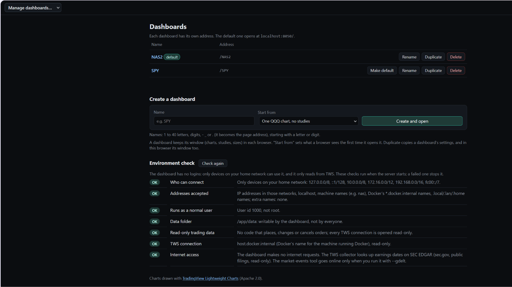

# Dashboards

A dashboard is a named window of charts with its own address: `http://<your-nas>:8050/<name>` (any letter
case). The drop-down at the top left of every page switches between them, and its last entry,
**Manage dashboards…**, opens `/dashboards`.

## Managing dashboards

On `/dashboards` you can:

- **Create** a dashboard: give it a name (it becomes the address). It starts as one QQQ chart with no
  studies, from one of your saved window layouts, from "Top and bottom rows of charts…" (any number of charts
  on top and below, 1 to 6 each), or from "Market internals" (a copy of the Internals dashboard below).
- **Rename** a dashboard, **duplicate** it, or **delete** it (you're asked to confirm).
- **Make default:** choose which dashboard opens at the plain address `/`.

The page also shows the **environment check** ([Purpose and security model](security.md)): one line per check,
with what to do about any that need attention.

## What is kept where

- The list of dashboards is kept on the NAS (`data/user/dashboards.json`), so every browser sees the same
  dashboards.
- A dashboard keeps its window (charts, studies, price types, sizes) in each browser. Duplicate copies a
  dashboard's window in the browser you duplicate it from.
- Saved views, saved layouts, watchlists and drawings are shared by all dashboards. To move a window to
  another browser, save it under **Layouts ▾** and load it there.

## The Internals dashboard

`http://<your-nas>:8050/Internals` (also in the drop-down), built in like thinkorswim's internals grid:
QQQ and SPY (3-minute, 2 days) over four market internals.

| Chart | What it is | Drawn as |
|---|---|---|
| `VOLD-NYSE` | NYSE up volume − down volume ($VOLD), in shares; shown as e.g. `25.04M` | line, EMA 8 |
| `-VIX` | the VIX upside down, as thinkorswim's −VIX (rising = volatility falling) | candles, EMA 9/21 cloud, Bollinger (20, 2) |
| `TICK-NYSE` | NYSE TICK ($TICK) | line, regular-hours high and low |
| `ADD-NYSE` | NYSE advancing − declining issues ($ADD) | candles, EMA 9/21 cloud, Bollinger (20, 2) |

- **History.** VIX and TICK come with history from TWS.
  - IBKR sends the NYSE advance–decline and up/down volume only as live quotes, with no history. So the
    collector records them in Live mode, 09:30–16:00, building 1-minute bars as `ADD-NYSE` and `VOLD-NYSE`.

  - Their history starts the day you start recording, so the 2-day view fills in over two sessions.
  - `RECORD` in `.env` turns recording off.
  - If IBKR won't give the collector one of them (for example, no market data for it), the collector logs
    "Not recording …" with the reason, keeps running, and the chart shows the reason too.

- **Market data.** VIX needs CBOE index data on your IBKR account; `tools/probe_ibkr.py` shows what your
  account delivers for each of these ([Market internals](tws.md#market-internals-nyse-tick-and-trin)).
- **Timeframes.** Minute candles are 1, 3, 5 or 15 minutes, so −VIX is 3-minute here (thinkorswim's is 2).
- **Not included.** The thinkorswim panels' arrows and BUY/SHORT-style labels are signals, and the dashboard
  draws none. The charts and their studies are ordinary charts: change them like any other.
- **More like it.** "Start from: Market internals" on the Dashboards page makes another copy. Deleting
  Internals is permanent; it isn't added back.
- **These symbols in any chart:** `-VIX`, `VIX`, `ADD-NYSE`, `VOLD-NYSE`, `TICK-NYSE`.
