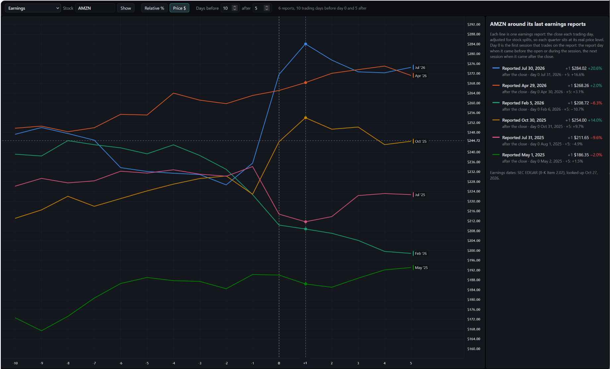

# Earnings view



`http://<your-nas>:8050/earnings` (also **Earnings** in the drop-down at the top left of every page).

**What it's for:** seeing how a stock has moved around its recent earnings reports, side by side, before
the next one. Type a stock and press Enter: its last 6 earnings reports are drawn over each other, one
coloured line each, with a legend.

## What a line is

The daily close from some trading days before to some after the report's **day 0**: 10 before and 5 after
unless you change **Days before / after** at the top (1 to 60 each, press Enter or leave the box; remembered
in this browser).

Two views, switched with **Relative %** / **Price $** at the top (remembered in this browser):

- **Relative %** (default): % change from the close the day before day 0. Every line starts from 0% at
  day −1, so the share price at the time doesn't matter. A stock that has tripled, re-rated or split still
  gives comparable lines.
- **Price $**: the close itself, adjusted for stock splits, so each quarter sits at its real price level.
  Hovering shows the price and the % change beside it.

**Day 0** is the first session that trades on the report:

- the report day itself, when the report came before the open or during the session
- the next session, when it came after the close

The legend shows which, with each quarter's day-0 move and its move by the last day shown (e.g. +5).

## Reading it

- Hover the chart to see every quarter's value at that day.
- Hover a legend row to pick out its line.
- Each line is labelled at its end (e.g. `Jul '26`), so you don't have to tell six colours apart.
- **Splits, in both views.** IBKR's daily prices are already adjusted for splits (checked against NVIDIA's 10:1
  split of June 2024). If a window still shows a jump the exact size of a split, the earlier closes are adjusted
  and the legend says so.

To compare the past moves with what the options price in for the next report, open the same stock in the
[Expected move view](expected-move.md).

## Where the data comes from

- Daily prices come from TWS, through the collector. The page asks for them, and shows progress while it waits.
- Earnings dates come from **SEC EDGAR**. US companies publish quarterly results with a form 8-K,
  Item 2.02, filed when the press release goes out. EDGAR keeps the time of each filing, which says
  whether the report came before the open or after the close.
- The collector looks the dates up when you open a stock, and again after 3 days. It caches them in
  `data/earnings/<SYMBOL>.json`.

## Turning it on

Set `SEC_CONTACT` in `.env` to your name and email, then restart:
`docker compose --profile collector up -d`. The SEC asks every program to name a contact; it's sent
only to sec.gov. Without it, the page says lookups are off.

## Not covered

- Funds and ETFs (they don't report earnings).
- Foreign companies that report with form 6-K instead of 8-K (e.g. ASML).

For those, write `data/earnings/<SYMBOL>.json` by hand. A file without `"fetched"` is never replaced:

```json
{"symbol": "ASML", "source": "by hand", "status": "ok",
 "earnings": [{"date": "2026-07-15", "time": "07:00"}, {"date": "2026-04-15", "time": "07:00"}]}
```

## Check it once

The collector's log lists the dates and times it found, e.g. `NVDA: 8 earnings reports found ... 2026-08-26 16:20`.
EDGAR's times are read as US/Eastern. If a known after-close report shows an evening time around 20:00 instead of
around 16:20, EDGAR's times are UTC after all. Day 0 would then be off for late-evening filings, and
`tools/earnings_sources.py` needs to convert them.

An Item 2.02 filing within 45 days of a later one (e.g. a preliminary-results notice) counts as part of that report.
