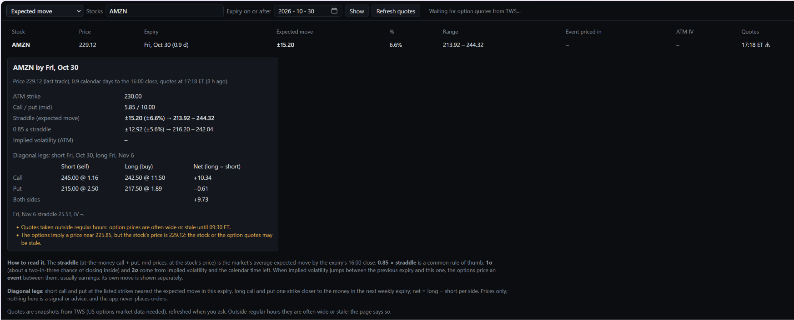

# Expected move view

`http://<your-nas>:8050/expected-move` (also **Expected move** in the drop-down at the top left of every page).

**What it's for:** how far the options market expects several stocks to move by a date (typically around
their earnings), and the legs of a diagonal placed at that move.

## Using it

1. Type one or more stocks (e.g. `AMZN LLY MA INTC MRK CAT`, up to 20) and a date.
2. Press **Show**. The first option expiry on or after that date is used: for a report on Thursday the 29th,
   pick the 29th or 30th to get Friday's expiry.
3. The page asks the collector for option quotes and fills in as they arrive (a few seconds per stock).

## The comparison table

One row per stock: price, expiry, the expected move in $ and %, the range it gives, the event priced in, and
the at-the-money implied volatility. Hover ⚠ for warnings.

## One card per stock

Each card shows how the numbers were found:

- **Straddle (expected move)**: the at-the-money call plus put (mid prices), interpolated between the strikes
  either side of the stock's price. This is the market's average expected move by the expiry's 16:00 close.
- **0.85 × straddle**: a common rule of thumb for a closer estimate of the typical move.
- **1σ and 2σ**: price × implied volatility × √(calendar time left, in years). About a two-in-three and a
  19-in-20 chance of closing inside, if moves were normally distributed.
- **Event before this expiry**: when implied volatility jumps (by 15% or more) from the previous expiry to this
  one, the options price an event between them, usually earnings. Its own move is
  price × √((IV² this expiry − IV² previous) × time left).
- **Diagonal legs.** Short call and put at the listed strikes nearest the expected move in this expiry; long call
  and put one strike closer to the money in the next weekly (the first expiry at least 7 days later). Each leg's
  mid price and the net per side (long − short). Prices only: no signal or advice, and the app never places
  orders. To evaluate the diagonal, build it in the [Option chain view](option-chain.md) with the
  *Double diagonal* template.

## Quotes and warnings

- **Fresh quotes.** Quotes older than 15 minutes are asked for again when you open the page; **Refresh quotes**
  asks right away. They're cached in `data/options/<SYMBOL>.json`.
- **Check the warnings.** The page says when quotes were taken outside regular hours, when a bid/ask spread is
  over 25% of the mid, or when the options imply a stock price more than 0.4% away from the stock's own (stale
  quotes somewhere). Before 09:30 ET, IBKR's option quotes are often too wide to use.
- **Needs** a US options market-data subscription in IBKR (OPRA). Without it, the page says no quotes came back.
- Strikes are read from the SMART chain; an expiry missing a strike is skipped, not interpolated.
